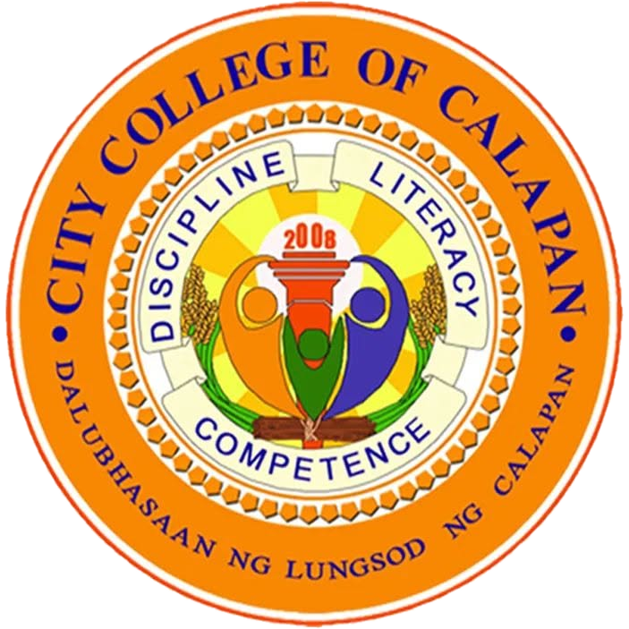
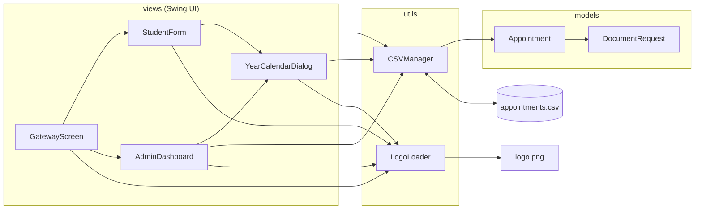
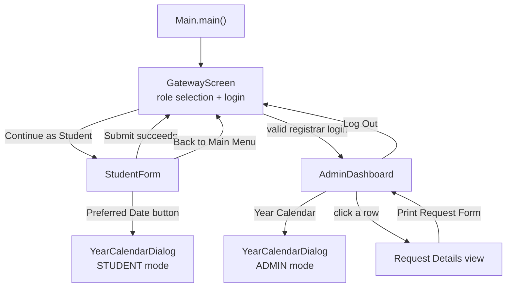
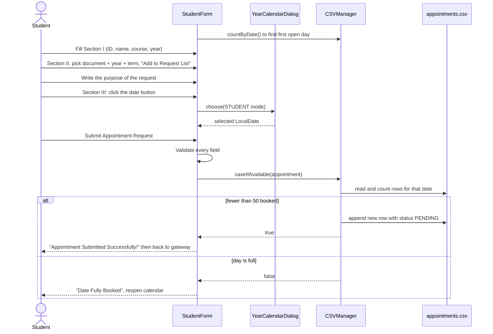
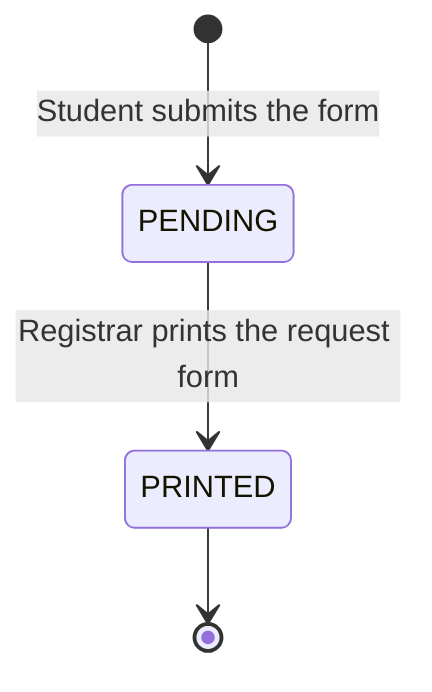
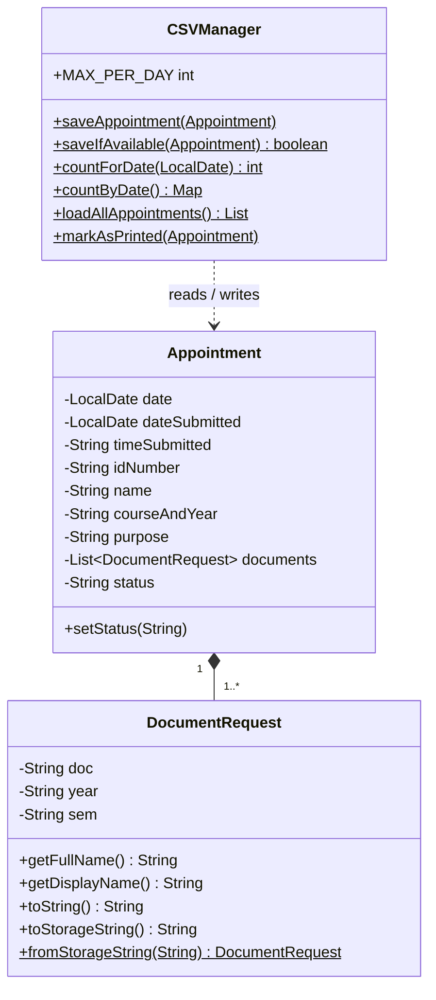

<p align="center">
  
</p>

<h1 align="center">City College of Calapan<br>Registrar Appointment System</h1>

<p align="center">
  A Java Swing desktop application that replaces the paper <em>"Appointment and Document Request Form"</em><br>
  with a student booking portal and a registrar dashboard, backed by a single CSV file.
</p>

<p align="center">
  
  
  
  
</p>

---

## Table of Contents

1. [Overview](#1-overview)
2. [Features](#2-features)
3. [Project Structure](#3-project-structure)
4. [Architecture](#4-architecture)
5. [How the System Works](#5-how-the-system-works)
6. [Business Rules](#6-business-rules)
7. [Data Model & Storage](#7-data-model--storage)
8. [File-by-File Reference](#8-file-by-file-reference)
9. [Getting Started](#9-getting-started)
10. [Configuration Cheat Sheet](#10-configuration-cheat-sheet)
11. [Known Limitations & Suggested Improvements](#11-known-limitations--suggested-improvements)

---

## 1. Overview

Students at City College of Calapan who need school records (a Certificate of Registration, Transcript of Records, Certificate of Graduation, etc.) normally fill out a paper form at the Registrar's office. This application digitizes that process.

**It has two sides:**

| Side | Who | What they do |
|---|---|---|
| **Student Portal** | Any student | Fills out the request form, picks the documents they need, and books a visit date. |
| **Registrar Dashboard** | Registrar staff (login required) | Sees who is coming on any given day, reviews each request, and prints the request slip. |

**Key idea:** the registrar can serve people per day as many as they want. Full days are shown in red on a year calendar and cannot be booked.

There is no database and no server. Everything is stored in one plain-text file, `appointments.csv`, so the app runs anywhere Java runs.

---

## 2. Features

### Student side
- **Paper-form look & feel.** The form is laid out in three numbered sections (I. Student Information, II. Document Request, III. Appointment Schedule) with ruled lines, mirroring the printed form it replaces.
- **Multi-document requests.** Add as many documents as needed to a request list, each tied to a specific school year and term. Duplicates are rejected.
- **17 requestable documents**, including COR, Certificate of Enrollment, Certificate of Grades, TOR, GWA, Diploma (2nd copy), CTC, OJT Clearance, and more.
- **Year calendar date picker** with live availability: color-coded days, "N slots left" tooltips, and past or full days blocked.
- **Automatic default date.** The form pre-selects the first upcoming day that still has room.
- **Input validation** with clear messages (ID format, required fields, empty request list, missing purpose, past dates).
- **Safe navigation.** Leaving the form with unsaved data asks for confirmation first.

### Registrar side
- **Orange-themed dashboard** with a sidebar, top bar, summary cards, and a searchable appointment table.
- **Four live summary cards** for the selected day: *Booked* (with a progress bar toward 50), *Pending Print*, *Printed* (with a percentage), and *Documents* (total documents requested).
- **Search and filter.** Free-text search across ID, name, purpose, course, and document names, plus **All / Pending / Printed** chips that show counts.
- **Compact documents column.** Shows the first document plus a `+N` badge, with a tooltip listing the rest.
- **Request detail view.** Click a row to see the full request as a formatted form slip.
- **One-click print** that renders a quarter-page version of the form and sends it straight to the computer's default printer — no print dialog, no manual switch to flip. If a printer is plugged in and set as the OS default, it just prints; if none is found, the registrar gets a clear warning instead of a silent failure.
- **Year calendar (2000-2100)** for jumping to any date, with the same availability colors.
- **Shortcuts.** *Today's Schedule* and *Refresh Data* buttons in the sidebar.

---

## 3. Project Structure

```
AppointmentSystem/
├── .idea/                      IntelliJ IDEA settings (auto-generated)
├── out/                        Compiled .class files (git-ignored)
├── src/
│   ├── Main.java               Entry point: sets the look & feel and opens the gateway
│   │
│   ├── models/                 Plain data classes (no UI, no file I/O)
│   │   ├── Appointment.java        One booking: student info + documents + status
│   │   └── DocumentRequest.java    One requested document (type + year + term)
│   │
│   ├── utils/                  Helpers shared by every screen
│   │   ├── CSVManager.java         All reading/writing of appointments.csv + the 50/day rule
│   │   └── LogoLoader.java         Finds, scales, and caches the school seal
│   │
│   └── views/                  Every Swing window
│       ├── GatewayScreen.java      Landing page: "Continue as Student" or registrar login
│       ├── StudentForm.java        The student's appointment & document request form
│       ├── AdminDashboard.java     Registrar dashboard, request detail view, printing
│       └── YearCalendarDialog.java Reusable 12-month calendar (student + admin modes)
│
├── .gitignore                  Ignores IDE/build output (IntelliJ, Eclipse, NetBeans, VS Code, macOS)
├── appointments.csv            The "database" (created automatically on first booking)
├── AppointmentSystem.iml       IntelliJ module file (source root = src/)
├── logo.png                    School seal, used in every window and on printed forms
└── README.md                   This file
```

> **Packages:** `models`, `utils`, and `views`. `Main` lives in the default package.
> **Build system:** none. It is a plain IntelliJ Java module with no Maven or Gradle and no external libraries.

---

## 4. Architecture

The code follows a simple layered design. **Views** talk to **utils**, which read and write **models**. Models know nothing about the layers above them.



### Screen navigation



Each screen opens the next one and calls `dispose()` on itself, so only one main window is on screen at a time. The calendar is the exception: it is a **modal dialog** that blocks its parent until a date is picked or the dialog is cancelled.

---

## 5. How the System Works

### 5.1 Startup (`Main`)
1. Sets the operating system's native look & feel (`UIManager.getSystemLookAndFeelClassName()`).
2. Opens `GatewayScreen` on the Swing event thread (`SwingUtilities.invokeLater`).

### 5.2 Gateway (`GatewayScreen`)
A single white card containing the school seal, name, and two paths:

- **Continue as Student** opens `StudentForm`. No login is needed.
- **Registrar Login** takes a username and password. On success it opens `AdminDashboard`.

The login handler gives specific feedback: missing username, missing password, wrong username, wrong password, or both wrong. The password field is cleared after a failed attempt, and pressing **Enter** triggers login.

### 5.3 Booking an appointment (`StudentForm`)



**Validation order on Submit:**
1. ID and name are not empty.
2. ID matches `\d+(-\d+)*` (digits and hyphens only, e.g. `2024-00123`).
3. The request list has at least one document.
4. The purpose is not empty. Whitespace is collapsed to single spaces so it stays on one CSV line.
5. A date is selected and it is not in the past.
6. `saveIfAvailable` confirms the day still has room. The check and the write happen together, so two students can't both take the last slot.

On success the new row is saved with:
- `date` = the day the student is **coming in**,
- `dateSubmitted` = **today**,
- `timeSubmitted` = current time in `hh:mm a` format (e.g. `09:34 PM`),
- `status` = **`PENDING`**.

### 5.4 The year calendar (`YearCalendarDialog`)
One class, two personalities, chosen by `Mode`:

| | `STUDENT` mode | `ADMIN` mode |
|---|---|---|
| Title | CHOOSE YOUR APPOINTMENT DATE | SELECT A DATE |
| Year range | Current year to next year | 2000 to 2100 |
| Past days | Greyed out, not clickable | Clickable |
| Full days | Red, click shows a "Day Full" warning | Red, clickable |
| Tooltip | "N slots left" / "FULL" / "already passed" | "N / 50 appointments" |
| Click result | Returns the date to the form | Returns the date to the dashboard |

**Day colors** (driven by how many appointments are booked on that date):

| Color | Meaning | Count |
|---|---|---|
| White | Open / no appointments | 0 |
| Light yellow | Some slots taken | 1-39 |
| Orange | Almost full | 40-49 (`ALMOST_FULL` = 80% of 50) |
| Red | **FULL** | 50 |
| Grey | Already passed (student mode only) | n/a |
| Blue ring | Today | n/a |
| Dark blue fill | Currently selected date | n/a |

The dialog loads all counts once with `CSVManager.countByDate()` when it opens. Press **Esc** to close it.

### 5.5 Registrar dashboard (`AdminDashboard`)

**Layout**
```
┌───────────────┬───────────────────────────────────────────────────────┐
│  SIDEBAR      │  TOP BAR   "Registrar Dashboard"       [avatar] Name  │
│  (orange)     ├───────────────────────────────────────────────────────┤
│               │  ┌────────┐ ┌─────────┐ ┌────────┐ ┌──────────┐      │
│  Dashboard    │  │ Booked │ │ Pending │ │Printed │ │Documents │      │
│  Year Calendar│  └────────┘ └─────────┘ └────────┘ └──────────┘      │
│  Today's Sched│  ┌─────────────────────────────────────────────────┐ │
│  Refresh Data │  │ [Search...........]        [All][Pending][Printed]│ │
│               │  │ Time │ ID │ Name │ Documents │ Purpose │ Status  │ │
│  [Log Out]    │  │ ...rows...                                       │ │
│               │  └─────────────────────────────────────────────────┘ │
└───────────────┴───────────────────────────────────────────────────────┘
```

**Two views** are swapped with a `CardLayout`:
- **`TABLE`**: the summary cards and appointment list.
- **`DETAILS`**: the formatted request slip for the selected row, with the print button.

**Data flow:** `loadTableData()` reads every row via `CSVManager.loadAllAppointments()`, then `populateTable()` keeps only the rows whose `date` equals `selectedDate` (default: today), applies the search text and status chip, and refreshes the cards, chip counts, footer text, and empty state.

**When the data is reloaded:** on startup, after picking a date in the calendar, when clicking *Today's Schedule* or *Refresh Data*, and after printing. There is **no auto-refresh**. If a student books while the dashboard is open, click **Refresh Data** to see it.

**Request details.** Selecting a row shows a form slip with the school letterhead, student ID, appointment date, name, course and year, date and time submitted, purpose, a numbered list of requested documents (full names such as *Certificate of Enrollment / Bonafide Student (2nd Year, 2nd Sem)*), and signature lines for the student and the registrar.

**Printing (`printSelected` and `FormPrintable`).**
1. Looks up the operating system's **default printer** with `PrintServiceLookup.lookupDefaultPrintService()` — whatever Windows (or the OS) currently has set as default, including one just plugged in and installed.
2. **No printer found** → shows a "No Printer Found" warning and stops there. The request stays `PENDING` so the registrar can plug one in and try again.
3. **Printer found** → builds a `PrinterJob` with a custom `Printable` that draws the form with Java2D at **quarter-page size**: half the printable width, anchored to the top-left, so four slips can be cut from one sheet. Long names and purposes are word-wrapped by real pixel width, and long document names are truncated with an ellipsis. The job is sent straight to that printer with `job.print()` — **no print dialog**, nothing for the registrar to confirm.
4. **Print failure** (out of paper, printer goes offline mid-job, etc.) → shows a "Print Error" message with the underlying cause. The request stays `PENDING`.
5. **Print succeeds** → calls `CSVManager.markAsPrinted(...)`, which changes `PENDING` to `PRINTED`, shows a success message, reloads the table, and returns to the list.

> Printing is fully automatic. Plug in and install a printer, set it as the system default, and the Print button sends the slip straight to it — there is no demo/simulation mode and no toggle to turn off. (If you've seen older docs mention a `SEND_TO_PRINTER` switch: that flag has been removed, see [§10](#10-configuration-cheat-sheet).)

Once a request is `PRINTED`, the button becomes a disabled red **"Already Printed"** and the status can't be changed back from the UI.

### 5.6 Status lifecycle



---

## 6. Business Rules

| Rule | Where it is enforced |
|---|---|
| **Max 50 appointments per day** (`MAX_PER_DAY`). Pending and printed both count. | `CSVManager.saveIfAvailable`, calendar colors, student form slot label |
| A student **cannot book a past date**. | `YearCalendarDialog` (greyed out) and `StudentForm.submit` |
| A student **cannot book a full day**. | Calendar click blocked and re-checked atomically at save time |
| Student calendar only offers **this year and next year**. | `YearCalendarDialog` (`minYear` / `maxYear`) |
| Student ID is **digits and hyphens only**. | `StudentForm.submit` |
| A request needs **at least one document** and a **purpose**. | `StudentForm.submit` |
| The **same document + year + term** can't be added twice. | `StudentForm.addDocument` |
| The 50 limit counts the **appointment day**, not the day of submission. | `Appointment.date` vs `Appointment.dateSubmitted` |
| Only a **PENDING** appointment can be marked PRINTED. | `CSVManager.markAsPrinted` |
| Slot label turns **orange at 10 or fewer slots left**, green otherwise. | `StudentForm.updateDateLabel` |

**Available choices on the form**

| Field | Options |
|---|---|
| Course | `BSIS`, `BSIT`, `BSEd` |
| Year level / School year | 1st, 2nd, 3rd, 4th Year |
| Term | 1st Sem, 2nd Sem |
| Documents (17) | COR; Certificate of Enrollment / Bonafide Student; Year Standing; Grades (per term); Transcript of Records (TOR); GWA; Units Earned; No Pending Disciplinary Case; No Contract / No Outstanding Obligation; Honorable Dismissal / Transfer Credential; Candidacy for Graduation; Graduation / Completion; Diploma / 2nd Copy; Certified True Copy (CTC); English as Medium of Instruction; OJT / Internship Clearance; Expected Date of Graduation |

---

## 7. Data Model & Storage

### 7.1 Classes



`Appointment` has two constructors. The long one takes both `date` and `dateSubmitted`. The short one is for old rows and sets `dateSubmitted = date`.

`DocumentRequest` renders itself three ways:

| Method | Example output | Used by |
|---|---|---|
| `toString()` | `Certificate of Registration (COR) - 1st Year, 1st Sem` | Student cart, dashboard table |
| `getDisplayName()` | `<full name> (1st Year, 1st Sem)` | Detail view, printed form, tooltips |
| `toStorageString()` | `Certificate of Registration (COR)~1st Year~1st Sem` | CSV file |

### 7.2 `appointments.csv` format

One appointment per line, **every field wrapped in double quotes** (`"` inside a value is escaped as `""`). There is **no header row**.

| # | Column | Example | Notes |
|---|---|---|---|
| 1 | `date` | `2026-10-10` | Appointment day (ISO format). **This is what the 50/day cap counts.** |
| 2 | `timeSubmitted` | `08:37 AM` | When the form was submitted |
| 3 | `idNumber` | `2024-00123` | Student ID |
| 4 | `name` | `Juan Dela Cruz` | Full name |
| 5 | `courseAndYear` | `BSIS - 1st Year` | `Course - Year` |
| 6 | `purpose` | `Scholarship requirement` | Single line |
| 7 | `documents` | `COR~1st Year~1st Sem\|TOR~2nd Year~2nd Sem` | Documents joined by `\|`, each as `name~year~sem` |
| 8 | `status` | `PENDING` or `PRINTED` | |
| 9 | `dateSubmitted` | `2026-10-08` | When the student filled in the form (ISO format) |

**Example row**
```csv
"2026-10-10","08:37 AM","2024-00123","Juan Dela Cruz","BSIS - 1st Year","Scholarship requirement","Certificate of Registration (COR)~1st Year~1st Sem|Transcript of Records (TOR)~2nd Year~2nd Sem","PENDING","2026-10-08"
```

### 7.3 Backward compatibility (the "legacy" rows)
The system evolved over time, and the loader copes with older data:

- **8-column rows** (written before `dateSubmitted` existed) still load; the submitted date defaults to the appointment date.
- **Short document codes** (`COG`, `COR`, `COE`) from an earlier version are expanded by `DocumentRequest.getFullName()` into *Certificate of Grades / Registration / Enrollment*. Newer rows store the full document name instead.
- **Malformed rows** (wrong column count or an unparseable date) are skipped silently instead of crashing the app.

### 7.4 How `CSVManager` stays safe
- All public methods are `synchronized`, so concurrent calls inside one running app can't interleave.
- `saveIfAvailable` performs **count then append as one step**, which is how the 50-per-day rule avoids a "last slot" race.
- `markAsPrinted` loads every row, flips one status, and rewrites the whole file.
- A hand-written CSV parser (`parseLine`) handles quoted fields, commas inside values, and `""` escapes.
- Files are read and written line by line with try-with-resources, so handles are always closed.

---

## 8. File-by-File Reference

| File | Package | Responsibility |
|---|---|---|
| `Main.java` | (default) | Sets the system look & feel, launches `GatewayScreen`. |
| `Appointment.java` | `models` | Immutable booking record. Only `status` can change. |
| `DocumentRequest.java` | `models` | One document + year + term. Handles display names and CSV encoding/decoding. |
| `CSVManager.java` | `utils` | The persistence layer. Defines `MAX_PER_DAY = 50`; saves, loads, counts, and updates appointments. |
| `LogoLoader.java` | `utils` | Loads `logo.png`/`logo.jpg` once, scales it in halving steps plus a final bicubic pass for a crisp seal, caches each size, and provides a `JLabel`, `ImageIcon`, or window icon. Falls back to a "LOGO" placeholder box if no file is found. |
| `GatewayScreen.java` | `views` | Landing and login screen. Flat orange buttons, focus-highlighted fields, `or` divider. |
| `StudentForm.java` | `views` | The three-section form, document "cart", date picker integration, validation, and submission. |
| `AdminDashboard.java` | `views` | Everything the registrar sees: sidebar, top bar, stat cards, table with custom renderers, detail slip, printing. About 2,000 lines, including a small custom UI toolkit (`FlatButton`, `StatCard`, `SearchField`, `RoundedPanel`, `Avatar`, `SlimScrollBarUI`, and hand-drawn icon glyphs). |
| `YearCalendarDialog.java` | `views` | Modal 12-month calendar with `DayCell` components painted per availability. |

**Logo lookup order** (`LogoLoader`): for `logo.png` then `logo.jpg`, it checks `./`, `src/`, `resources/`, and finally the classpath root.

---

## 9. Getting Started

### Requirements
- **JDK 8 or newer.** No third-party libraries. The code uses only the Java standard library (`javax.swing`, `java.awt`, `java.time`, `java.io`, `javax.imageio`).
- A desktop environment (this is a GUI app).

### Option A: IntelliJ IDEA (how the project was built)
1. **File → Open** and select the `AppointmentSystem` folder.
2. Set the Project SDK (any JDK 8+).
3. Open `src/Main.java` and click **Run ▶**.

IntelliJ uses the project root as the working directory, so `appointments.csv` and `logo.png` are found automatically.

### Option B: Command line
Run from the **project root** (the folder containing `src/`, `logo.png`, and `appointments.csv`):

```bash
# macOS / Linux
mkdir -p out
javac -d out $(find src -name "*.java")
java -cp out Main
```

```powershell
# Windows PowerShell
New-Item -ItemType Directory -Force out | Out-Null
javac -d out (Get-ChildItem -Recurse src -Filter *.java).FullName
java -cp out Main
```

> **Working directory matters.** `appointments.csv` is read from and written to the *current working directory*. Launch from a different folder and the app will start a fresh, empty data file there. The logo is searched for in the working directory, `src/`, and `resources/`.

### First run
- If `appointments.csv` doesn't exist, it is created when the first student books.
- **Registrar login:** username `admin`, password `admin123`.

---

## 10. Configuration Cheat Sheet

| What to change | File | Setting |
|---|---|---|
| Daily appointment limit | `CSVManager.java` | `MAX_PER_DAY` (calendar thresholds recompute automatically; "almost full" is 80% of this) |
| Registrar username / password | `GatewayScreen.java` | `ADMIN_USER`, `ADMIN_PASS` |
| Which printer is used | Operating system | None in code — printing always targets whatever the OS has set as the **default printer** (`PrintServiceLookup.lookupDefaultPrintService()`). Change the default printer in your OS settings to redirect it. |
| Available documents | `StudentForm.java` | `DOCUMENTS` array |
| Courses offered | `StudentForm.java` | `courseBox` (`"BSIS", "BSIT", "BSEd"`) |
| Year levels | `StudentForm.java` | `YEARS` array |
| Student booking window | `YearCalendarDialog.java` | `minYear` / `maxYear` in the constructor |
| Data file location | `CSVManager.java` | `FILE_PATH` |
| Brand colors | `GatewayScreen`, `StudentForm`, `AdminDashboard` | `ORANGE` / `COLOR_PRIMARY` (`217, 101, 14`) and related constants |
| School seal | project root | Replace `logo.png` (square images work best) |

---

## 11. Known Limitations & Suggested Improvements

This section lists things that are true of the current code. None of them stop the app from working, but they are worth knowing before a real deployment.

**Security and privacy**
 **Hard-coded registrar credentials** (`admin` / `admin123`) in plain text. Move them to a hashed, external store before real use.
  **Data integrity**
-  `synchronized` only protects *one running copy* of the app. If a student kiosk and the registrar PC run **separate copies against the same shared file**, they can overwrite each other (especially `markAsPrinted`, which rewrites the whole file). A real database (SQLite, MySQL) would solve this.
-  `markAsPrinted` identifies a row by **date + time submitted + student ID**. Two pending requests from the same ID in the same minute would be ambiguous (the first match wins).
-  Document names are stored using `~` and `|` as separators. A document name containing either character would break parsing (none of the current 17 do).
-  The CSV has no header row and no schema version; the loader relies on column count (8 vs 9) to detect old rows.

**Functionality gaps**
-  Always prints to the OS **default printer** — there's no in-app picker for a different installed printer, and no print preview before the job is sent.
-  The dashboard has **no auto-refresh**. New bookings appear after **Refresh Data**.
-  No way to **cancel, reschedule, or edit** a booking, and no way to revert a printed request.
-  The cap is **per day**, not per time slot, and there is no blocking of weekends or holidays.
-  Students are not verified: anyone can enter any ID.
-  `DocumentRequest.getFullName()` only expands the old codes `COG`/`COR`/`COE`; newer rows already store full names.

**Ideas for the future**
- Email or SMS confirmation to the student.
- Appointment reference numbers or QR codes on the printed slip.
- Export reports (daily summary to PDF or Excel).
- Holiday and closed-day management for the registrar.
- A status for "Released / Claimed" after the document is picked up.

---

<p align="center">
  <sub>Built for the Office of the Registrar, City College of Calapan.<br>
  <em>Dalubhasaan ng Lungsod ng Calapan</em> · Discipline · Literacy · Competence</sub>
</p>
